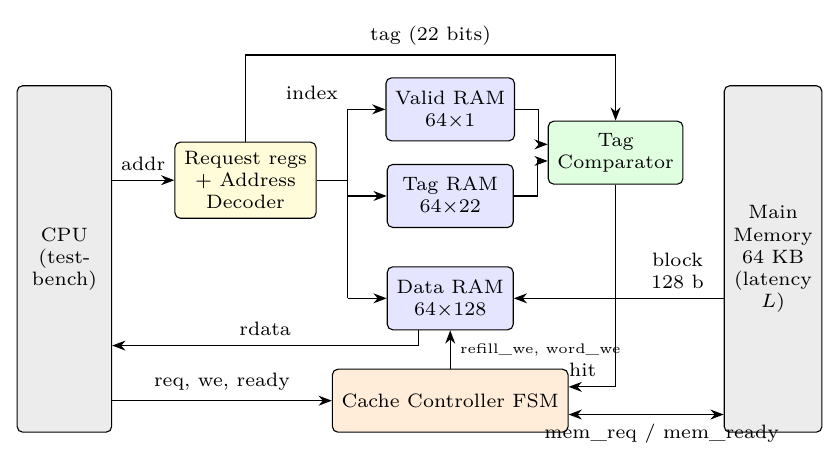
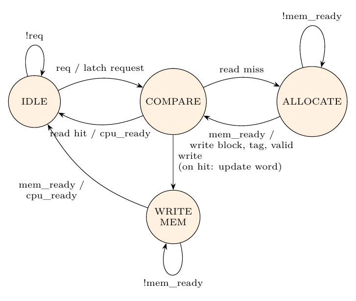

# Direct-Mapped Cache Controller (Project 6) — Modern Computer Architecture

A **1 KB direct-mapped cache** with **16-byte blocks** and **32-bit addresses**, written in Verilog.
We simulate it with memory-access traces and measure **hit ratio, miss ratio and AMAT**
(Average Memory Access Time), and we synthesise it for an FPGA.

**Demo video:** _add the link here_  
**Report:** [`report/main.pdf`](report/main.pdf)

## Team

| Member | Contribution |
|--------|--------------|
| Asad Ali | Tag/index/offset derivation, `address_decoder.v`, `tag_comparator.v` |
| Divyansh Bhartia | Cache storage: `data_ram.v`, `tag_ram.v`, `valid_ram.v` |
| Vikrant Yadav | `main_memory.v` (memory interface) and trace generator `gen_traces.py` |
| Mayank Pillai | Controller FSM `cache_controller.v` and top level `cache_top.v` |
| Prashant Raj | Testbench `tb_cache.v`, hit/miss statistics, AMAT analysis, synthesis |

## How the cache works (in one minute)

The 32-bit address is split into three fields:

```
| 31 ............ 10 | 9 ....... 4 | 3 ...... 0 |
|      TAG (22)      |  INDEX (6)  | OFFSET (4) |
```

* **INDEX** picks one of the 64 lines (1024 B / 16 B = 64).
* **TAG** says which memory block is stored in that line.
* **OFFSET** picks the byte in the 16-byte block (bits [3:2] pick one of 4 words).

**Hit** = line is valid **and** stored tag == address tag.
On a **read miss**, the whole 16-byte block is fetched from main memory, written into the line, and the tag
and valid bit are set. Writes use **write-through, no-write-allocate**: they always go to memory and update
the cache only if the block is already there.



### Controller FSM

| State | What happens |
|-------|--------------|
| IDLE | Wait for a request and latch address/data |
| COMPARE | Check valid + tag. Read hit → return data. Read miss → ALLOCATE. Write → WRITE_MEM |
| ALLOCATE | Fetch the block from memory, write block + tag + valid, go back to COMPARE |
| WRITE_MEM | Write the word to memory (write-through), then done |



## Results (main-memory latency = 10 cycles)

Hit time = 2 cycles, miss penalty = 12 cycles, so **AMAT = 2 + miss rate × 12**.

| Trace | What it shows | Hit ratio | AMAT (cycles) |
|-------|---------------|-----------|---------------|
| sequential | spatial locality (1 miss + 3 hits per block) | 75.0 % | 5.00 |
| repeated | temporal locality (loop over 512 B, fits in cache) | 97.5 % | 2.30 |
| random | almost no locality | 1.1 % | 13.87 |
| conflict | 2 addresses 1 KB apart fight for one line | 0.0 % | 14.00 |
| mixed | reads + writes, checks write-through | 29.6 % | 10.45 |

All traces pass the self-check (every read compared with a reference memory, 0 errors).
Synthesis (Yosys, Xilinx 7-series): **316 LUTs, 138 flip-flops, 136 RAM64M** (distributed RAM).

## Repository structure

| Folder / file | Contents |
|---------------|----------|
| `rtl/` | Verilog design: `cache_params.vh`, `address_decoder.v`, `tag_comparator.v`, `valid_ram.v`, `tag_ram.v`, `data_ram.v`, `cache_controller.v`, `cache_top.v`, `main_memory.v` |
| `tb/tb_cache.v` | Self-checking testbench that replays a trace and prints the statistics |
| `traces/` | Memory-access traces (`R addr` / `W addr data`) |
| `scripts/` | `gen_traces.py`, `run_all.sh`, `latency_sweep.sh`, `make_plots.py`, `vcd_to_tikz.py` |
| `results/` | `summary.csv`, `latency_sweep.csv`, per-access logs `*_log.txt` (hit/miss report) |
| `synth/` | Yosys script and synthesis report |
| `report/` | IEEE report (`main.tex`, `main.pdf`) and figures |
| `docs/` | Project brief, figures (PNG), video script and team Git guide |

## How to run

Install the free tools (macOS with Homebrew; on Ubuntu use `sudo apt install iverilog yosys`):

```bash
brew install icarus-verilog yosys
```

Run all traces (prints a summary for each trace and writes `results/`):

```bash
./scripts/run_all.sh
```

Run the latency sweep (5–100 cycle memory):

```bash
./scripts/latency_sweep.sh
```

Run one trace and save a waveform (`results/cache_wave.vcd`, open with GTKWave or Surfer):

```bash
vvp -n results/sim.vvp +trace=traces/demo.txt +name=demo +vcd
```

Synthesise:

```bash
yosys -s synth/synth.ys
```

Rebuild the report (needs [Tectonic](https://tectonic-typesetting.github.io) or any LaTeX):

```bash
python3 scripts/make_plots.py && cd report && tectonic main.tex
```
